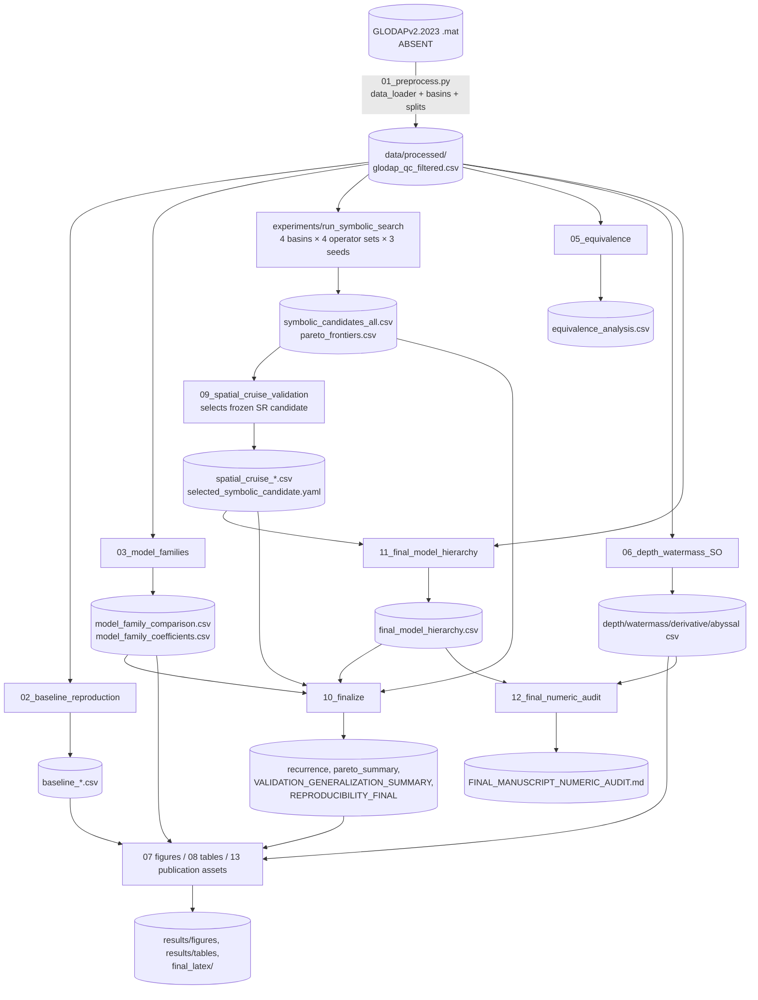
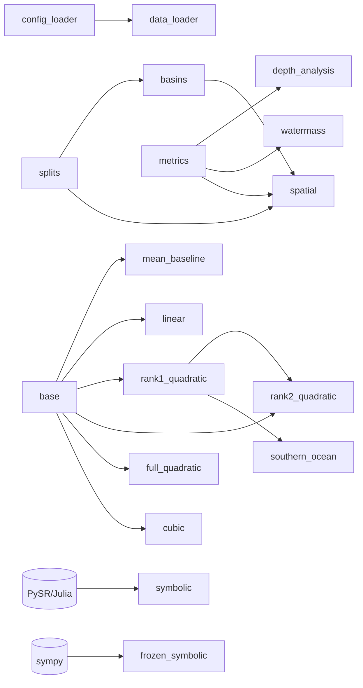

# Repository Intelligence Report

*Branch:* `research/dev` (created from `main` @ `22a2165`, clean working tree at creation).
*Inspection date:* 2026-11-04.
*Scope note:* Every file in the active pipeline (`src/`, `scripts/`, `experiments/`, `config/`, `tests/`) was read in full. Legacy material (`paper_final/`, `other/`) was inspected at the level of docstrings, I/O calls and purpose; it is **not** fully audited line-by-line. Generated artifacts (PNG, TeX tables, PDFs) were listed, not opened. See `FILE_AUDIT.csv` for per-file status.

---

## 1. What this repository is

An empirical study of how ocean **total dissolved inorganic carbon** (TCO2, a.k.a. DIC; µmol kg⁻¹) depends on three hydrographic predictors — **salinity (S), in-situ temperature (T), apparent oxygen utilisation (AOU)** — using GLODAPv2.2023 bottle data. The current manuscript (“How Low-Dimensional Is the S–T–AOU Dependence of Ocean TCO2?”) argues that a 5-parameter **rank-1 quadratic**

    TCO2 = (αS + βT + γ·AOU/100 + δ)² + ε

captures most of the predictive structure, that rank-2 adds nothing, and that symbolic regression (PySR) finds only modestly better (3–12 % RMSE) but 2–3× more complex expressions.

The repository has gone through at least three generations, all still present:

| Generation | Location | Status |
|---|---|---|
| G1: “Southern Ocean CO2(aq)” ML/PySR project (RF, XGBoost, SHAP, CO2(aq) via gsw) | `paper_final/src/`, `paper_final/results/phase2-3` | Obsolete; different target variable |
| G2: “discovered quadratic law” paper + a long series of fix scripts (`z_fix1..4`, `z_master_fix`, `validation_*`, CANYON-B attempts, Revelle-factor analysis) | `paper_final/*.py`, `paper_final/latex`, `other/` | Obsolete; reads raw `.mat` which is absent |
| G3: “revised study” — modular `src/` package + numbered `scripts/` | `src/`, `scripts/`, `experiments/`, `config/`, `results/`, `final_latex/`, `submission/` | **Active** |

## 2. Condensed directory tree

```
RE-project/
├── README.md                    # G3 overview; Quick Start; claims "no hard-coded results"
├── config/                      # YAML: paths, QC, basins, splits, seeds, PySR spaces, frozen SR candidate
├── data/processed/              # glodap_qc_filtered.csv (512,384 rows × 14 cols, 46 MB), basin_counts, qc_stats
│   (data/raw/ is ABSENT — GLODAPv2.2023 .mat not in repo)
├── environment/                 # environment.yml, requirements.txt, julia/VERSIONS.md
├── src/                         # G3 library (≈2.3 k lines)
│   ├── config_loader.py, data_loader.py, basins.py, splits.py
│   ├── models/      mean, linear, rank1, rank2, full_quadratic, cubic, symbolic (PySR), frozen_symbolic
│   ├── analysis/    metrics, pareto, family_classification, depth, watermass, derivatives, southern_ocean
│   ├── validation/  bootstrap, equivalence (TOST), spatial (GroupKFold)
│   └── visualization/ (EMPTY — only __init__.py; README lists 7 modules that do not exist)
├── scripts/                     # 01–13 numbered pipeline + run_all.py (stale)
├── experiments/                 # run_symbolic_search.py (the PySR run actually used), analyze_pareto.py
├── tests/test_basins.py         # 22 unit tests (basins, splits, models, metrics, TOST, Pareto)
├── results/                     # processed CSVs, raw SR candidates (599), LaTeX tables, figures, 11 audit/summary .md
├── logs/, outputs/              # PySR log & hall-of-fame checkpoint
├── final_latex/, submission/, paper/, paper_build/   # 4 copies of manuscript sources/PDFs (partly divergent)
├── paper_final/                 # G1/G2 legacy (≈12 k lines of scripts, 89 artifacts, 2 joblib models)
└── other/                       # G2 scratch scripts + glodap_canyonb_results.csv (519,597 rows, 33 MB)
```

Full listing: `FILE_AUDIT.csv` (one row per file, 470+ rows).

## 3. Software architecture (active G3 pipeline)



Module dependency graph (imports):



Every script re-reads the processed CSV, re-assigns basins, and re-creates the temporal split; there is no shared cached state. Scripts communicate only through files in `results/`.

## 4. Dataset inventory

| Dataset | Location | Rows | Variables | Provenance / notes |
|---|---|---|---|---|
| **GLODAPv2.2023 merged master (.mat)** | `data/raw/` | 1,402,829 (per `qc_stats.json`) | all GLODAP | **Not in repo.** Required by `01_preprocess.py` and every G2 script. |
| **Processed QC set** | `data/processed/glodap_qc_filtered.csv` | 512,384 | salinity, temperature (in-situ °C), aou, tco2, latitude, longitude, depth (m), year, month, region, cruise, station, basin, split | Output of `01_preprocess.py`. **No QC flags, no pressure, no θ, no oxygen, no nutrients, no TAlk, no pH, no CFCs.** |
| Basin counts / QC stats | `data/processed/*.csv/json` | — | — | Atlantic 147,448; Indian 40,391; Pacific 187,443; Southern Ocean 97,248; Unclassified (GLODAP region 4 = Arctic) 39,854 |
| CANYON-B run output | `other/glodap_canyonb_results.csv` | 519,597 | lat, lon, pres, temp, sal, oxy, dic_true, canyon_dic | From `other/canyonb2.py`, which used a **fixed date 2020-01-01** for all rows (self-documented as an error in `paper_final/canyonb3.py`). No year/cruise key → cannot be safely joined. |
| G1 Southern Ocean set | `paper_final/data/processed/southern_ocean_training.csv` | 13,191 | + pressure, stratification_index, c_atm, co2_aq | Legacy; different target. |
| `other/compressed_data.csv` | `other/` | 49,161 | (binary / non-UTF8) | Unknown provenance; not used by any script. |
| SR candidate library | `results/raw/symbolic_regression/` | 599 candidates | equation, complexity, loss, RMSE_val, family | PySR 2.3.0, Python 3.14.3, 48 runs. |

### 4.1 Data characteristics observed directly
* Years 1972–2021; strongly uneven: < 3,500 obs yr⁻¹ before 1989, peak 1992–1997 (WOCE), ~15–22 k yr⁻¹ 2001–2018, then sparse (2019: 9.3 k; 2020: 4.4 k; 2021: 9.2 k).
* 836 cruises, 29,731 cruise×station profiles.
* `depth` (m) is used; `pressure` was not extracted. Temperature is **in-situ**, not potential/conservative.
* Basin definition: region code (1 Atlantic incl. Mediterranean, 8 Pacific, 16 Indian) north of 35°S, everything south of 35°S = Southern Ocean; Arctic (region 4) silently dropped.

## 5. Existing scientific methods

| Component | Method | File |
|---|---|---|
| QC | finiteness + open-interval range filters: 25<S<42, −2.5<T<35, 1700<TCO2<2600, AOU>−50 | `src/data_loader.py` |
| Splits | temporal: train <2015, validation 2015–17, external ≥2018 | `src/splits.py` |
| Models | mean; OLS linear (AOU/100); rank-1 quadratic (scipy `curve_fit`); rank-2 quadratic (Nelder–Mead, 5 restarts, 9 params); full quadratic & cubic (OLS on raw AOU); PySR (4 operator sets, maxsize ≤25, 30 k subsample, 3 seeds) | `src/models/` |
| Selection | SR candidate with minimum 2015–17 RMSE per basin is frozen | `scripts/09` |
| Blocked CV | GroupKFold(5) on pre-2018 data by 5°×10° block or cruise | `scripts/09` |
| Inference | per-observation TOST on paired |error| differences; “cluster” bootstrap of mean paired difference | `src/validation/equivalence.py` |
| Diagnostics | depth bins; threshold water masses (Surface/Thermocline/AAIW/NADW/AABW); analytic derivatives of rank-1; SO abyss global-vs-local refit; AIC/BIC on training data | `src/analysis/` |
| PIs | empirical 2.5/97.5 % quantiles of training residuals | `scripts/13` |

## 6. Existing research question(s) and hypotheses

* **Central question (explicit):** How low-dimensional is the S–T–AOU dependence of TCO2, and how much accuracy survives increasingly strong structural constraints?
* **H1:** rank-1 quadratic ≈ full quadratic in accuracy (equivalence within ±2 µmol kg⁻¹).
* **H2:** rank-2 does not improve on rank-1 ⇒ curvature is effectively one-dimensional.
* **H3:** PySR repeatedly rediscovers the rank-1 form across seeds/operator sets.
* **H4 (implicit):** the relationship is temporally stable (“robust temporal transferability”).

## 7. Current experimental results (as saved, and independently re-checked)

I re-implemented the rank-1 and full-quadratic fits from scratch (scratch script, not repo code) and reproduced the published numbers:

| Basin | rank-1 val / ext RMSE (repo) | rank-1 (mine) | full-quad val (repo / mine) |
|---|---|---|---|
| Atlantic | 20.17 / 17.67 | 20.17 / 17.67 | 23.41 / 23.41 |
| Indian | 14.48 / 18.41 | 14.48 / 18.41 | 13.73 / 13.73 |
| Pacific | 16.00 / 13.82 | 16.00 / 13.82 | 15.50 / 15.43 |
| Southern Ocean | 10.58 / 8.99 | 10.58 / 8.99 | 10.46 / 10.25 |

Rank-1 is exactly reproducible from the processed CSV. Full-quadratic differences in Pacific/SO (0.07, 0.21 µmol kg⁻¹) are consistent with numerical ill-conditioning of OLS on raw AOU² (~10⁵) — the repo’s `FullQuadratic` does not scale AOU while `LinearModel` does.

Other saved results: rank-2 vs rank-1 validation ΔRMSE = +1.99/+0.26/−0.29/−0.04; SR best 5.8/11.6/3.2/5.6 % better than rank-1; rank-1 “family” present in 24/48 SR cells; SO abyss (>3000 m) global R² = −0.17 vs local R² = 0.79; Atlantic AAIW bias +27 µmol kg⁻¹.

## 8. Critical findings from inspection (bugs, technical debt, scientific problems)

### 8.1 A systematic time signal is being treated as error (most important)
All models show a **positive bias** in the 2015–17 validation (+2 to +9 µmol kg⁻¹) and ≥2018 external (+4 to +11) periods, but ≈0 bias in blocked CV that mixes years. A diagnostic I ran (residuals of a pre-2015 full-quadratic fit, regressed on year within depth bins) gives a residual drift of **≈0.6–1.0 µmol kg⁻¹ yr⁻¹ in the upper 100 m, decaying to ≈0–0.2 µmol kg⁻¹ yr⁻¹ below 2000 m, in every basin** — the canonical vertical signature of anthropogenic CO2 invasion. Adding a single linear `year` term to the full quadratic cuts the external bias from +4…+8 to −0.9…+1.7 µmol kg⁻¹ and lowers external RMSE by 1.1–2.2 µmol kg⁻¹ in every basin — a larger effect than any rank-1/rank-2 difference on which the manuscript’s main claim rests.

Consequences:
* “Robust temporal transferability” (H4) is not supported as stated: the temporal holdout errors are partly a deterministic, physically expected trend.
* Temporal-validation **rankings** of model families (e.g. Atlantic rank-1 20.2 vs full-quad 23.4) are comparisons of how each functional form *extrapolates in predictor space under a shifted, carbon-enriched ocean* — not clean tests of dimensionality. In blocked CV (no time shift) the Atlantic ranking reverses (rank-1 16.3 vs rank-2 15.5 vs full-quad 15.6).
* Caveat: these drift numbers are naive pooled OLS slopes; they are confounded by changes in where/when cruises sampled and are not yet a defensible estimate.

### 8.2 Structural/statistical issues
1. **Nesting ignored.** Rank-1 is a constrained special case of both rank-2 and the full quadratic. Their *training* RMSE is always ≤ rank-1 (confirmed: Atlantic 15.70 → 14.65 → 14.44). “Rank-2 overfits” with 4 extra parameters on 125 k observations is implausible; out-of-sample losses reflect covariate/temporal shift, not variance.
2. **Cluster bootstrap is incorrect.** `src/validation/bootstrap.py` and `equivalence.bootstrap_paired_ae_diff` use `np.isin(groups, sampled_groups)`, which drops duplicate draws; each replicate is a ~63 % sub-sample of clusters, not a bootstrap. CIs are therefore mis-calibrated.
3. **Naive TOST** treats ~10⁴ correlated observations as iid → all margins (even ±1 µmol kg⁻¹) “pass”; this result is uninformative.
4. **Frozen SR candidate in blocked CV leaks.** Its constants were fit on all pre-2015 data (incl. the test blocks) while parametric competitors are refit per fold.
5. **SR selection optimism.** The frozen SR candidate is chosen as min-RMSE over 599 candidates on 2015–17 and then that same RMSE is reported.
6. **Family classifier is string-heuristic.** `family_classification.classify_structure` labels any expression without `square/exp/log/sqrt` and without textual cross-terms as “linear” (incl. rational forms); “rank-1 quadratic” label is assigned to any expression containing a square and no literal cross-term — not a test of rank. `pareto.classify_equation_family` looks for `x0/x1/x2` while equations use `sal/tmp/aou100` → returns “constant” for all (used by stale script 04 only). The 24/48 recurrence statistic inherits this.
7. **Hard-coded results** in `scripts/10_finalize_analysis_outputs.py` (`rank1_rmse = {...}`) contradict the README claim.
8. **Derivative analysis** (`scripts/06`) evaluates on all rows including the external holdout; harmless for sign checks but violates the stated lock.
9. **Physical variables.** In-situ T (not θ/Θ); depth not pressure; AOU depends on T,S via O2 solubility (so S,T,AOU are not independent “drivers”); preformed DIC and the solubility pump are not represented; no TAlk ⇒ carbonate-system reasoning (Revelle, CaCO3 dissolution) is impossible with the processed data.
10. **No GLODAP quality flags used.** GLODAP’s `G2tco2f` (WOCE flag 2 = good, 0 = interpolated/calculated) and secondary-QC adjustments are ignored; calculated TCO2 values may be mixed with measured ones.
11. **Water-mass rules** use in-situ T and depth thresholds, NADW is defined globally (not Atlantic-only), and the Atlantic AAIW class is defined only south of 15°S.
12. **Arctic dropped** silently (39,854 rows).

### 8.3 Engineering debt
* `src/visualization/` is empty; README describes seven modules that don’t exist.
* `scripts/run_all.py` runs stale step 04 (not `experiments/run_symbolic_search.py`), omits 09–13, and shells out to bare `python`.
* `scripts/04_pysr_pareto_search.py` is superseded and uses the broken classifier.
* `experiments/run_symbolic_search.py` silently caps the YAML PySR settings (populations ≤20, niterations ≤50, maxsize ≤25) — the published search is smaller than `config/pysr_config.yaml` states.
* Four manuscript copies (`final_latex/`, `submission/manuscript_source/`, `submission/manuscript.tex`, `paper/latex/`) with divergent content; `submission/verification_report.md` itself flags stale claims.
* `environment.yml` pins Python <3.14 but results were produced with 3.14.3.
* `.gitignore` excludes `*.csv`/`*.png`/`data/` yet these were force-committed in `22a2165`.

## 9. Reproducibility assessment

| Item | Status |
|---|---|
| Raw data | ✗ absent; SHA recorded only if present (`REPRODUCIBILITY_FINAL.yaml`) |
| Processed data → parametric results | ✓ rank-1 reproduced exactly; full-quad within 0.2 µmol kg⁻¹ |
| SR results | ? not re-run (Julia/PySR 2.7.2 installed vs 2.3.0 used; serial deterministic mode should help) |
| Pipeline orchestration | ✗ `run_all.py` stale; README sequence is the correct one |
| Tests | 22 tests exist; not executed by me (sandbox policy blocked running repo code) |
| Environment | ✓ `.venv` (Python 3.12.16, PySR 2.7.2, Julia 1.13.3) created on this machine |

## 10. Scientific assumptions and limitations (of the existing work)

* Stationarity: TCO2(S,T,AOU) assumed time-invariant over 1972–2021 (violated; §8.1).
* Basin-wise fixed coefficients; no spatial structure beyond basin.
* Observations treated as exchangeable within basin for fitting; dependence only addressed in post-hoc validation.
* AOU assumed to be a clean remineralisation tracer (ignores O2 disequilibrium at outcrop, esp. Southern Ocean — known to bias AOU-based estimates).
* Measurement uncertainty (GLODAP DIC consistency ~4 µmol kg⁻¹) not propagated; reported RMSE differences of 0.04–0.3 µmol kg⁻¹ are far below it.

## 11. Unexplored research opportunities (to be vetted in Phases 2–5)

1. **Time as a state variable**: quantify the residual DIC drift at fixed (S,T,AOU) — i.e., an S–T–AOU analogue of eMLR — and test whether its vertical/basin structure matches independent anthropogenic-carbon estimates.
2. **Re-assessing “low-dimensionality” after removing the time signal**: does the rank-1 vs rank-2 vs full-quad ranking survive once non-stationarity is modelled and dependence-correct inference is used?
3. **Validation-design sensitivity**: show quantitatively how temporal vs blocked vs random splits change model rankings in GLODAP regressions (a methodological contribution relevant to CANYON-B/ESPER/LIR-type tools).
4. **Abyssal & AAIW failure diagnosis** with proper tracers (θ, pressure, nutrients, TAlk, CFC-derived ages) — requires raw GLODAP.
5. **Dependence-aware uncertainty** for empirical DIC algorithms (correct cluster bootstrap, cruise-level effective sample size).
6. **Measurement-flag sensitivity** (measured vs calculated TCO2) — requires raw GLODAP.

Items 4 and 6 (and any carbonate-system analysis) require the GLODAPv2.2023 merged product, which is not in the repository.

---
## 12. Round-2 addendum (2026-11-14)

**New modules.**
* `research/models/differential_trend.py`: cruise-FE differential estimator with an exact two-way FE solver (`exact_twoway`).
* `research/experiments/e06…e12`: Round-2 experiments.
* `research/evaluation/summarize_round2.py`: Round-2 summaries.
* `research/visualization/figures_round2.py`: Figs. 1 (now with coastlines) and 7–11.
* `tests/test_research_estimators.py`: estimator unit tests.

All of these were authored and read in full.

**External data (untracked, read-only, checksummed).**
* `data/external/gruber2019/…_94-07_vs1.nc`
* `data/external/mueller2023/dcant_emlr_cstar_mueller_94-04-14.nc` (+ README PDF)

**Environment.** `.venv` (Python 3.12, uv), TRACE-Python v1.1.2 installed from the checksummed release zipball. `data/raw/GLODAPv2.2023_Merged_Master_File.mat` on this machine is a symlink into `../continued_project/paper_final/data/raw/` (SHA-256 verified).

**Status changes to §8–9.**
* The repository test suite was run for the first time: 22/22 pass once `sympy` is installed (it was missing from the environment, not from `requirements.txt`).
* Round-1 results reproduce bit-for-bit on a second machine.
* `build_dataset.py` gained nutrient secondary-QC columns.

**Known stale artifact.** `paper/pitch_for_professor.pdf` (Round 1) predates the Round-2 results and should be regenerated before it is shared.
